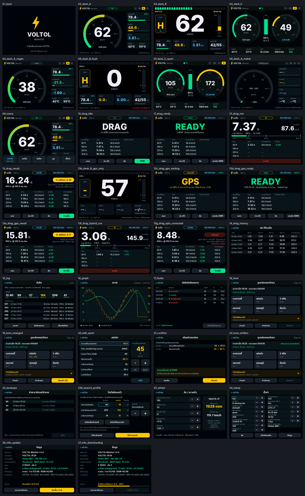
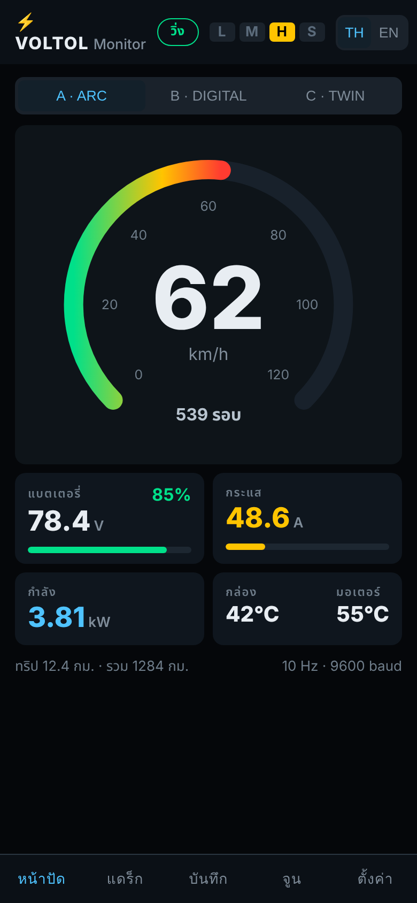

# VOLTOL Monitor

หน้าปัด + เครื่องบันทึก + จับเวลา 402 m + จูนพารามิเตอร์ สำหรับกล่องคอนโทรลเลอร์ **VOTOL EM-series**
(โปรโตคอลถอดจากโปรแกรมจูนทางการ EM_V3-40 / EM_V3-EMsport)

| บอร์ด | ไฟล์ | ใช้งาน |
|---|---|---|
| **ESP32-3248S035 (CYD 3.5", ทัช resistive)** | `VOLTOL_CYD35_*.bin` | จอบนรถ + หน้าเว็บ |
| **ESP32-S3 DevKitC-1 (flash 8 MB)** | `VOLTOL_S3_*.bin` | ไม่มีจอ ใช้หน้าเว็บบนมือถือทั้งหมด |

## การต่อสาย

| VOTOL (ปลั๊กโปรแกรม UART) | CYD 3.5" |
|---|---|
| TX | IO35 |
| RX | IO22 |
| GND | GND |

- ไฟเลี้ยงบอร์ด 5V จาก DC-DC ของระบบ 12V (ห้ามต่อแรงดันแบตเข้าบอร์ดตรง)
- สัญญาณ UART ของ VOTOL เป็น 3.3V ถ้ากล่องรุ่นไหนเป็น 5V ให้ใส่ตัวต้านทานแบ่งแรงดัน (1k / 2k) ที่ขา IO35
- GPS (ไม่บังคับ): GPS TX → IO21, **GPS RX → IO22 (สายเดียวกับ VOTOL RX ต่อแยกเป็นตัว Y ได้)**, 3.3V, GND
  บอร์ดตั้งค่าโมดูล u-blox ให้อัตโนมัติ (115200, 10/25 Hz, NAV-PVT) ผ่านสาย IO22

### ESP32-S3 DevKitC-1

| สาย | GPIO |
|---|---|
| VOTOL TX | GPIO18 |
| VOTOL RX + GPS RX | GPIO17 |
| GPS TX | GPIO16 |
| GND | GND |
- microSD (อนาคต): ใส่การ์ด FAT32 ในช่องของบอร์ด ระบบจะเก็บ log ลงการ์ดแทนหน่วยความจำภายในเอง

## แฟลชเฟิร์มแวร์ (Windows)

> **อัปจาก v1.2.x เป็น v1.3.0 บนจอ CYD ต้องแฟลชผ่าน USB 1 ครั้ง** ด้วย `FLASH_CYD35_WINDOWS.bat`
> (v1.3.0 ขยายพื้นที่โปรแกรมเพื่อใส่ฟอนต์ภาษาไทย ค่าตั้ง log และค่าสำรองบนบอร์ดจะถูกล้าง ต้องคาลิเบรตจอใหม่)
> ก่อนแฟลช ให้ดาวน์โหลดไฟล์ใน `/bk/` (ค่าสำรองพารามิเตอร์) จากหน้าเว็บ LOG → Files เก็บไว้ก่อน
> หลังจากนั้นอัปเดตผ่าน OTA / UPDATE .bat ได้ตามปกติ · ESP32-S3 ไม่ต้องทำอะไรเพิ่ม (OTA ได้เลย)

1. แตกไฟล์ zip ไฟล์ `.bin` อยู่ในโฟลเดอร์ `firmware/`
2. ครั้งแรก: ดับเบิลคลิก `FLASH_CYD35_WINDOWS.bat` (หรือ `FLASH_S3_WINDOWS.bat`) ใส่ COM port (ล้างบอร์ดทั้งหมด)
3. อัปเดตครั้งต่อไป: `UPDATE_CYD35_WINDOWS.bat` / `UPDATE_S3_WINDOWS.bat` (เก็บค่าตั้ง, log, backup ไว้) หรืออัปโหลด
   `*_APP_UPDATE.bin` ผ่านหน้าเว็บของบอร์ด (SETUP → Firmware update)
4. เปิดครั้งแรกจะให้แตะลูกศร 4 มุมเพื่อคาลิเบรตทัชสกรีน

## การใช้งาน

- **ภาษา ไทย / English**: จอ CYD → SETUP → แถวแรก "ภาษา / Language" · หน้าเว็บ → ปุ่ม TH / EN มุมขวาบน
  (หน้าเว็บจำภาษาไว้ในมือถือแต่ละเครื่อง) · หัวคอลัมน์ไฟล์ CSV เป็นภาษาอังกฤษเสมอเพื่อเปิดใน Excel ได้ง่าย

- **แตะหน้าปัด** = เปิดเมนู: STYLE (สลับหน้าปัด A/B/C) · DRAG · LOG · TUNE · SETUP
- **SETUP → WHEEL**: ใส่ขนาดยาง (เช่น 130/70-17) และอัตราทด (ฮับมอเตอร์ = 1.00) เพื่อให้ความเร็วถูกต้อง
- **DRAG**: กด ARM → จอดนิ่ง (ขึ้น READY) → ออกตัว ระบบจับ 60 ft / 100 m / 201 m / 402 m พร้อม trap speed
  - จาก RPM (สาย UART): เริ่มทันทีที่ล้อหมุน ~±0.05 s
  - จาก GPS (ใช้เดี่ยว ๆ ไม่ต่อกล่องก็ได้): READY เมื่อ ≤1 km/h นาน 1 วินาที, เริ่มเมื่อ >3 km/h แล้วคำนวณย้อนหาจุดออกตัว
    ต้องมีดาวเทียม ≥6 ดวงและความแม่นยำความเร็ว ≤±1 km/h จึงจะขึ้น READY · แนะนำ u-blox M10 ที่ 25 Hz
  - SETUP → Drag rollout: OFF หรือ 1 ft (แบบสนามแข่ง เริ่มนับหลังรถเคลื่อน 1 ฟุต)
  - **ล้อฟรี**:
    - ต่อทั้งกล่องและ GPS = โหมด HYBRID: จังหวะออกตัวจาก RPM, ระยะ/เวลาจาก GPS, แสดง % slip สด + max slip ในผล
    - RPM อย่างเดียว: SETUP → Max traction (ค่าเริ่ม 1.6 g) ถ้าล้อเร่งเกินค่านี้ระบบจำกัดความเร็วไว้ที่ค่านี้
      รอบนั้นติดป้าย SPIN-CORRECTED และไม่นับเป็น best
    - TUNE → LAUNCH PROFILE: เก็บค่า Street / Launch (Rate of rise, Start torque, Soft-start grade) แล้วสลับก่อนแข่ง
- **LOG**: สรุปทริป, กราฟความเร็ว/กระแส, รายการ fault
- **TUNE**: READ อ่านพารามิเตอร์ (สำรองอัตโนมัติทุกครั้งที่ค่าเปลี่ยน) → แก้ค่า → WRITE
  - เขียนได้เฉพาะตอน RPM = 0 ต้องกดยืนยัน และอ่านค่ากลับมาเทียบทุกไบต์
  - ปุ่ม **ขั้นสูง: ปิด/เปิด** (ADVANCED) ซ่อนค่าที่เสี่ยงทำให้มอเตอร์ผิดปกติ ได้แก่ Pole pairs, Hall shift angle,
    T.C.1-3, Low/High protect, Undervoltage variation · ค่าเริ่มต้น = ซ่อน (ตั้งได้ทั้งบนจอและหน้าเว็บ)
  - BACKUPS → RESTORE กู้ค่าเดิมได้
  - คำสั่ง bootloader / อัปเฟิร์มแวร์กล่อง **ไม่มีอยู่ในเฟิร์มแวร์นี้**

## หน้าเว็บ (ทั้ง CYD และ ESP32-S3)

เชื่อม Wi-Fi `VOLTOL-xxxx` (รหัส `voltol1234`) แล้วเปิด http://192.168.4.1
แท็บ DASH (หน้าปัด A/B/C) · DRAG (ARM/ผลจับเวลา/ประวัติ) · LOG (กราฟ, ทริป, fault, ดาวน์โหลด CSV) ·
TUNE (อ่าน/แก้/เขียนพารามิเตอร์ + backup/restore — เขียนได้เฉพาะ 0 RPM และต้องยืนยัน) · SETUP (ทุกค่าตั้ง + อัปเฟิร์มแวร์)
หน้าเว็บตั้งนาฬิกาของบอร์ดจากมือถือให้อัตโนมัติ

## อัปเดตเฟิร์มแวร์ (OTA)

- **ผ่านหน้าเว็บ**: SETUP → Firmware update → เลือก `*_APP_UPDATE.bin`
- **ผ่านอินเทอร์เน็ต**: หน้าเว็บ SETUP → Internet Wi-Fi ใส่ชื่อ/รหัส Wi-Fi บ้านหรือฮอตสปอตมือถือ
  บอร์ดเช็กเวอร์ชันใหม่จาก GitHub ทุก 6 ชม. → กด INSTALL บนจอ (SETUP → INFO) หรือบนเว็บ
  ไฟล์ถูกตรวจ SHA-256 ก่อนติดตั้งเสมอ
- **ป้องกัน**: อัปเดตไม่ได้ถ้า RPM ≠ 0 หรือกำลังจับเวลา Drag · ถ้าเวอร์ชันใหม่รีสตาร์ต 3 ครั้งภายใน 60 วินาที
  จะกลับไปใช้เวอร์ชันเดิมเอง

## ไฟล์ Log (CSV เปิดใน Excel ได้)

| ไฟล์ | เนื้อหา |
|---|---|
| `/log/T0001_detail.csv` | ทุกเฟรม (~10 ครั้ง/วินาที): เวลา, km/h, RPM, A, V, W, อุณหภูมิ, เกียร์, สถานะ, fault, ระยะ |
| `/log/T0001_sec.csv` | 1 แถว/วินาที: เฉลี่ย / ต่ำสุด / สูงสุด ของ km/h, RPM, A, V, อุณหภูมิ, Wh สะสม |
| `/faults.csv` | เวลาเกิด/หายของ fault + ข้อมูล 5 วินาทีก่อนเกิด (แถว PRE) |
| `/trips.csv` | สรุปแต่ละทริป: km, max/avg km/h, max A, Wh, Wh/km |
| `/drag.csv` | ผลจับเวลา 402 m ทุกรอบ |
| `/bk/NNN.bin` | สำรองพารามิเตอร์ 119 ไบต์ (`/bk/index.csv` = รายการ) |

หน่วยความจำภายใน: CYD 192 KB (ไฟล์ละเอียดไม่กี่นาทีล่าสุด — แนะนำใส่ microSD) · ESP32-S3 3.9 MB (~1.5 ชม.) — ไฟล์เก่าถูกลบอัตโนมัติ · CYD ใส่ microSD เพื่อเก็บทั้งหมด

## สำหรับนักพัฒนา

- `include/votol_proto.h` โปรโตคอล VOTOL (เฟรม 24 ไบต์, XOR, SHOW / LDGET / P1-P7 / CLERR) + ตารางพารามิเตอร์
- `include/ride.h` ความเร็ว/ระยะ/ทริป/จับเวลา drag, `include/gps.h` NMEA
- `src/ui.cpp` ทุกหน้าจอ — คอมไพล์บน PC ได้ด้วย `tools/sim` แล้ว `tools/render_screens.py` สร้างภาพตัวอย่างจากโค้ดจริง
- ทดสอบ: `g++ -std=c++17 -Iinclude -o t test/proto_test.cpp && ./t` (ใช้เฟรมจริงที่ดักจากโปรแกรมจูนทางการ)
- GitHub Actions build ทุก push แล้ววางไฟล์ไว้ที่ branch `firmware-build`

ฟอนต์ Inter และ Noto Sans Thai (SIL Open Font License 1.1) — `assets/fonts/LICENSE_Inter_OFL.txt`, `assets/fonts/LICENSE_NotoSansThai_OFL.txt`
